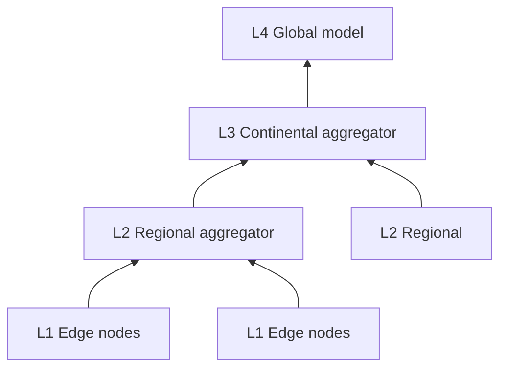

# Architecture Overview — Sovereign Mohawk

**Status**: Real content as of 2026-11-04; verified against commit `9d9181a22`.

## 1. What this system is

Sovereign Mohawk is a theorem-guided federated-learning runtime: edge devices
train locally, gradients flow up a four-tier hierarchy (L1 Edge -> L2 Regional
-> L3 Continental -> L4 Global), and each tier aggregates with Byzantine
filtering and privacy accounting. Lean 4 formal proofs cover *models* of the
key invariants, each with a recorded status and scope; refinement bridges
connect some of them to Go predicates, and those correspondences are
**empirical**, not machine-checked. See §5.

## 2. Tier hierarchy

- **L1 Edge**: local training, gradient production.
- **L2 Regional**: first aggregation, Byzantine filtering (Multi-Krum).
- **L3 Continental**: cross-regional aggregation.
- **L4 Global**: final model update.

## 3. Core components

| Component | Package | Role |
|---|---|---|
| Federation | `internal/federation/` | Tier hierarchy, gradient forwarding, streaming aggregation |
| Multi-Krum | `internal/multikrum.go` | Byzantine filtering (single-tier, formalized) |
| Streaming aggregator | `internal/streaming_aggregator.go` | Chunk assembly, batching |
| Transport | `internal/transport/` | MRC multi-path packet spraying |
| PQC crypto | `internal/crypto/` | Hybrid KEX x25519-mlkem768 |
| TPM attestation | `internal/tpm/` | Hardware-backed identity (Linux TPM) |
| RDP accounting | `internal/rdp_accountant.go` | Privacy budget (epsilon = 2.0) |
| ZK verifier (legacy) | `internal/zksnark_verifier.go` | genesisVK (fixed identity) |
| ZK verifier (circuit) | `internal/zksnark_circuit_verifier.go` | Circuit-derived VK + MPC setup |
| Formal proofs | `proofs/` | Lean 4 theorems + refinement bridges |

## 4. Data flow (one round)

1. Edge nodes compute gradients and submit them for aggregation. (There is no
   per-gradient "Byzantine-resilience proof" attached at the edge; Byzantine
   filtering happens at the aggregation tier.)
2. Gradients stream (gRPC `ReceiveGradients`) to the regional aggregator.
3. Regional runs Multi-Krum filtering (`n > 2f+2`), aggregates survivors.
4. Aggregated gradient forwards to continental, then global.
5. Global updates the model; new round begins.

## 5. Formal verification status

See `proofs/FORMAL_TRACEABILITY_MATRIX.md` and `docs/EXTERNAL_AUDIT_SCOPE.md`.
Key honesty notes: hierarchical BFT composition is **disproven** (there is a
machine-checked counterexample), and only single-tier Multi-Krum plus a
probabilistic Chernoff repair under an explicit sampling model are
machine-checked; the MPC trusted setup is simulated in-process; the Lean
development is axiom-free and sorry-free, with two explicit hypotheses
(`FloatOrderLaws` and `Fact (Nat.Prime dlL)`); and no claim is a machine-checked
statement about the deployed Go binary.

## 6. Cross-references

- Byzantine resilience: `docs/architecture/BYZANTINE_RESILIENCE.md`
- Differential privacy: `docs/architecture/DIFFERENTIAL_PRIVACY.md`
- Streaming aggregator: `docs/architecture/STREAMING_AGGREGATOR.md`
- Transport: `docs/architecture/TRANSPORT_LAYER.md`
- Federation protocol: `docs/architecture/FEDERATION_PROTOCOL.md`
- Gossip: `docs/architecture/GOSSIP_PROTOCOL.md`
- Routing/topology: `docs/architecture/ROUTING_TOPOLOGY.md`
- Integration points: `docs/architecture/INTEGRATION_POINTS.md`
- API reference: `docs/api/API_REFERENCE.md`
